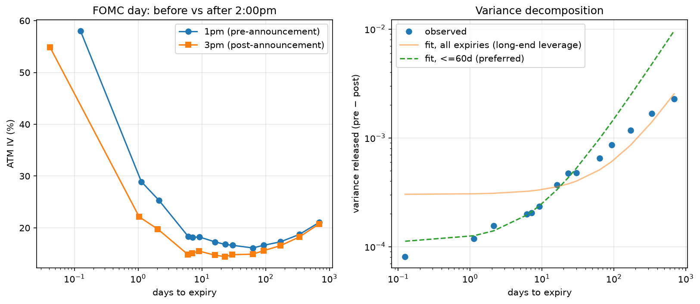

# SPY Implied Volatility Surface — pricing a scheduled event

A Black-Scholes pricer and implied-volatility solver written from scratch, an
automated pipeline that reconstructs SPY's full volatility surface from live
option chains each trading day, and a measurement of what the options market
charged for the FOMC announcement of **July 29, 2026** — and how fast that
charge disappeared once the announcement landed.

---

## The result

> The market priced the Fed announcement at about **±0.95%** of SPY movement.
>
> **It was the event, not the market.** Expiries 1–2 days out fell **5–7
> volatility points in two hours**; the 2-year expiry moved **0.3**. A
> market-wide shift moves everything together — only an event produces that
> shape.
>
> **It stuck.** The next day's snapshot showed the 15–30 day expiries within
> **0.25 points** of where the announcement left them.
>
> **A forecast written at 1:00pm**, before the outcome existed, predicted
> ±1.07% by the close. SPY moved −0.67%.

±0.95% is a point estimate; other defensible methods give 0.5%–1.1%. One
meeting, so this is a quantified case study of a known effect, not a
statistical result.



*Left: at-the-money volatility by expiry, before and after 2:00pm. Right: the
variance released, by maturity.*

---

## How it works

```
yfinance option chain
        |
        v
  filter: OTM only, bid>0, spread/mid<0.5, open interest>0
        |
        v
  mid price = (bid+ask)/2
        |
        v
  Brent root-find on Black-Scholes          <- dollars into volatility
        |                                      (failures flag bad quotes)
        v
  normalise: log-moneyness, T in years, delta
        |
        v
  stack expiries -> the volatility surface
        |
        v
  daily CSV snapshot (one-shot; chains cannot be re-queried)
        |
        v
  calibrate the forward, extract ATM volatility per expiry
        |
        v
  difference-in-differences across expiry x time
        |
        v
  event premium, and the implied move it corresponds to
```

Five things worth knowing about the design:

- **Implied volatility is a root-find.** Black-Scholes has no algebraic inverse
  in `sigma`, so recovering it from a market price means solving numerically.
  When the solver *fails*, that's information — no volatility reproduces that
  price, so the quote violates a no-arbitrage bound. The solver doubles as a
  data-quality filter.
- **Variance, not volatility, is the working quantity.** Variance adds over
  time, so differences between expiries are meaningful and a parallel shift in
  the surface cancels out of them.
- **Expiries are selected by target date, not list position.** Selecting by
  position seems equivalent and isn't — see the bugs section.
- **The pre/post pair is two hours apart, same day**, because the FOMC
  statement lands at 2:00pm ET. A day-over-day comparison would confound the
  effect with a full session of unrelated movement.
- **Every snapshot is unrepeatable.** Historical option chains aren't
  retrievable, so the stored schema is deliberately wider than the analysis
  needs.

---

## Two bugs worth reading about

**The expiry ladder was rotating.** Expiries were selected by *position* in a
list. As contracts expired the list shifted, so a different set was tracked
each day — **41 distinct expiries across 13 snapshots, none appearing in more
than 6.** Found two days before the event; any later and the measurement would
have been unusable.

**The spot and option feeds disagreed.** A put and a call one strike apart
implied 33.3% and 20.4%. Put-call parity showed the quotes priced a spread at
**$1.48 against a $1.00 ceiling** — impossible. Diagnosis: the price feed ran
about a point stale against the option chain. The error's *decay with maturity*
confirmed it, since a real market feature wouldn't fade that way.

---

## Limitations

- **n = 1.** One meeting. Nothing here shows this happens *reliably*.
- **A concurrent market-wide move can't be separated from the spot move.** SPY
  rose 0.96% between snapshots; with skew, that alone shifts at-the-money
  volatility. One event can't resolve how much was real.
- **One snapshot can't distinguish a level from a spike.** The 3:00pm reading
  landed near a transient peak — SPY fell ~12 points in the next 55 minutes.
- **The noise test is inconclusive**, and can't be computed at the maturities
  where the effect is largest.

---

## Repo map

| file | what it is |
|---|---|
| `main.py` | Black-Scholes pricer, implied-vol solver, delta; assert-based tests |
| `data.py` | chain pull, filtering, expiry ladder, surface construction |
| `collect.py` | one daily snapshot; `--label` for intraday runs |
| `run_collect.sh` | scheduled runner — verifies output, rebases, retries the push |
| `surface_io.py` | loads both CSV schema versions into one frame |
| `analysis.py` | forward calibration, event decomposition, charts |
| `test_surface_io.py` | regression tests for the loader |
| `data/` | one CSV per snapshot |
| `charts/` | generated figures |
| `EXPLAINER.md` | **the full story**, written for someone without options background |
| `RESULTS.md` | the formal record — every number, and what went wrong when |
| `notes.md` | working log and collection instructions |

---

## Running it

```bash
pip install yfinance pandas numpy scipy matplotlib

python main.py              # pricer tests
python test_surface_io.py   # loader tests
python collect.py           # one snapshot -> data/
python analysis.py          # full analysis + charts (~4 min)
```

---

**For the full story:** [`EXPLAINER.md`](EXPLAINER.md) — concepts, then the
project in chronological order, then the findings.
**For every number:** [`RESULTS.md`](RESULTS.md).
